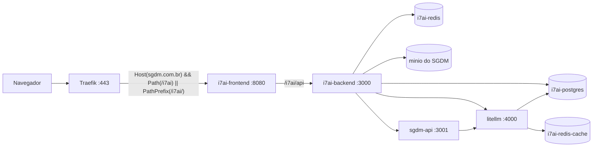

# Stack i7Ai no Portainer (ao lado do SGDM)

O i7Ai (Central de IA) e o LiteLLM sobem como **stack Swarm própria**, `i7ai-plataforma`, na mesma VPS do SGDM, atrás do Traefik. Endereço final: `https://sgdm.com.br/i7ai`.

> **Nome da stack: `i7ai-plataforma`.** Já existe uma stack `i7ai` (site institucional) — não use esse nome nem apague essa stack.

---

## Visão geral



| Serviço (no Swarm: `i7ai-plataforma_<serviço>`) | Redes | Observação |
|-------|--------|------------|
| `i7ai-postgres` | `interna` | pgvector; usuário e banco `i7ai`; banco `litellm` criado na 1ª subida |
| `i7ai-redis` | `interna` | filas BullMQ; com senha e AOF |
| `i7ai-redis-cache` | `interna` | só o cache exato do LiteLLM; senha própria (`REDIS_CACHE_PASSWORD`), 200 MB, `allkeys-lru`, sem disco |
| `litellm` | `interna` + `SGDMNET` | o SGDM chama `http://litellm:4000` |
| `i7ai-backend` | `interna` + `SGDMNET` | migrations e bucket no entrypoint |
| `i7ai-frontend` | `SGDMNET` | rota do Traefik `i7ai_plataforma` |

Nenhuma porta é publicada; só o Traefik expõe 80/443. Os nomes `postgres`, `redis` e `sgdm-api` na `SGDMNET` são do SGDM — por isso Postgres e Redis do i7Ai se chamam `i7ai-*` e ficam fora da `SGDMNET`. O armazenamento de arquivos é o **MinIO compartilhado do SGDM** (`http://minio:9000`, resolvido só na `SGDMNET`): o i7Ai usa o bucket `i7ai-documents` e um usuário próprio (`I7AI_S3_ACCESS_KEY` / `I7AI_S3_SECRET_KEY`) com política restrita a esse bucket, criados antes do deploy (passo 6.1 de [docs/DEPLOY_VPS.md](../docs/DEPLOY_VPS.md)). A stack não sobe MinIO próprio: o MinIO deixou de publicar imagens públicas.

---

## Fase 1 — Primeira subida

### 1.1 Imagens

O workflow do GitHub Actions publica:

- `ghcr.io/jeferson-assis/i7ai-backend:main`
- `ghcr.io/jeferson-assis/i7ai-frontend:main`

Confira em **GitHub → Packages** que os dois pacotes estão **públicos**.

### 1.2 Variáveis

Copie [`stack.env.example`](./stack.env.example) e gere cada segredo com `openssl rand -hex 32` (os valores de exemplo começam com `change-` e o backend os recusa em produção). Um valor vem da stack `sgdm-app` e outro vai para ela:

| Variável do i7Ai | Valor |
|------------------|-------|
| `SGDM_JWT_SECRET` | copie o `JWT_SECRET` da stack `sgdm-app` |
| `SGDM_INTEGRATION_KEY` | gere aqui, uma vez; depois copie PARA o `I7AI_INTEGRACAO_CHAVE` da stack `sgdm-app` |

Guarde `LITELLM_SALT_KEY` em local seguro: trocá-la depois deixa ilegíveis as chaves de provedor já cadastradas.

### 1.3 Criar a stack no Portainer

**Stacks → Add stack**, método **Repository** (obrigatório: a stack lê `deploy/litellm/config.yaml` e `portainer/litellm-db.sql` do repositório como *configs* do Swarm, por caminho relativo — o Web editor não tem esses arquivos).

| Campo | Valor |
|-------|--------|
| Nome | `i7ai-plataforma` |
| Método | **Repository** |
| URL | `https://github.com/JEFERSON-ASSIS/i7ai-prefeituras.git` |
| Branch | `main` |
| Compose path | `portainer/i7ai.stack.yml` |
| Environment variables | o conteúdo preenchido de `stack.env.example` |

**Deploy the stack.** Variável obrigatória esquecida = o deploy para com `Set <VARIÁVEL>`, nunca sobe vazio.

### 1.4 Conferir

```bash
docker stack services i7ai-plataforma          # todos 1/1
docker service logs i7ai-plataforma_i7ai-backend --tail 50   # migrations + "bucket" + API no ar
curl -s https://sgdm.com.br/i7ai/api/health    # {"status":"ok",...}
```

Abra `https://sgdm.com.br/i7ai` logado no SGDM.

> O banco `litellm` é criado pelo `litellm-db.sql` **só quando o volume do Postgres está vazio** (primeira subida). Se o volume já existia sem ele:
> `docker exec -it $(docker ps -qf name=i7ai-plataforma_i7ai-postgres) psql -U i7ai -d i7ai -c 'CREATE DATABASE litellm'`

---

## Fase 2 — Atualizações

Todo `git push` na `main` publica novas imagens `:main` no GHCR. Para aplicar:

**Opção A — Portainer:** stack `i7ai-plataforma` → **Pull and redeploy** (marque *Re-pull image*).

**Opção B — VPS:**

```bash
docker service update --with-registry-auth --image ghcr.io/jeferson-assis/i7ai-backend:main  i7ai-plataforma_i7ai-backend
docker service update --with-registry-auth --image ghcr.io/jeferson-assis/i7ai-frontend:main i7ai-plataforma_i7ai-frontend
```

Backend e frontend usam `update_config: order: start-first, failure_action: rollback`: a versão nova sobe ao lado da antiga e, se não ficar saudável (por exemplo, migration que falhou), o Swarm volta sozinho para a anterior. O motivo fica em `docker service logs i7ai-plataforma_i7ai-backend`.

**Alterou `deploy/litellm/config.yaml`?** Configs do Swarm são imutáveis: no mesmo commit, troque o sufixo do `name` da config (hoje `i7ai_litellm_config_v2`; a próxima alteração usa `_v3`) em `i7ai.stack.yml`, senão o redeploy falha.

Para fixar uma versão, defina `I7AI_IMAGE_TAG` (padrão `main`) nas variáveis da stack.

---

## Atualizações automáticas (GitHub Actions)

Todo push na `main` roda **Docker Publish** (publica `i7ai-backend` e `i7ai-frontend` no GHCR) e, ao terminar com sucesso, **Deploy VPS** atualiza por SSH `i7ai-plataforma_i7ai-backend` e depois `i7ai-plataforma_i7ai-frontend`. Também dá para rodar à mão em Actions › Deploy VPS.

Em Settings › Secrets › Actions de `JEFERSON-ASSIS/i7ai-prefeituras`, copie do repositório do SGDM:

- `VPS_HOST`, `VPS_USER`, `VPS_SSH_KEY`
- `VPS_PORT` (opcional, padrão 22)
- `VPS_STACK_NAME` (opcional, padrão `i7ai-plataforma`)

Uma vez só, depois do primeiro Docker Publish: GitHub → Packages → tornar `i7ai-backend` e `i7ai-frontend` públicos (ou `docker login ghcr.io` na VPS). Os pacotes do GHCR nascem privados.

---

## Rollback

| Situação | Comando |
|----------|---------|
| Voltar a versão anterior de um serviço | `docker service rollback i7ai-plataforma_i7ai-backend` (ou `_i7ai-frontend`) |
| Tirar o i7Ai do ar (SGDM continua) | `docker stack rm i7ai-plataforma` |

`docker stack rm` remove só os serviços desta stack; os volumes (`i7ai-plataforma_i7ai_postgres`, `_i7ai_redis`) ficam, e um novo deploy volta com os mesmos dados. Nada do SGDM é alterado.

---

## Arquivos

| Arquivo | Uso |
|---------|-----|
| `i7ai.stack.yml` | Stack Portainer/Swarm |
| `stack.env.example` | Variáveis (só exemplos; segredos ficam no Portainer) |
| `litellm-db.sql` | Cria o banco `litellm` na primeira subida do Postgres |
| `../deploy/litellm/config.yaml` | Modelos do LiteLLM |
